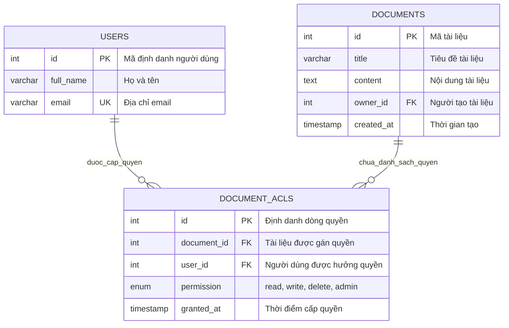
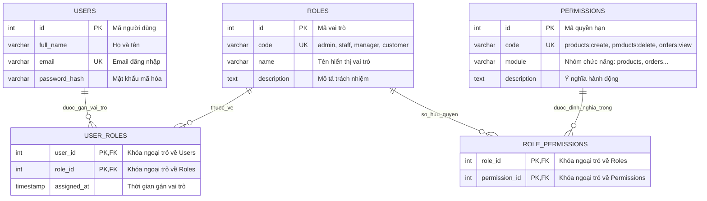
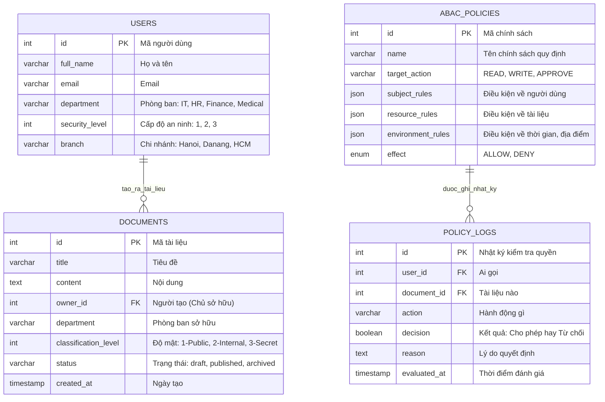

# Buổi 10 — Phân Quyền Trong Backend (Authorization: ACL, RBAC, ABAC)


---

## 🎯 Mục tiêu buổi học

Sau khi đọc kỹ tài liệu này và tham gia buổi training, bạn sẽ:
- **Phân biệt rạch ròi bản chất** giữa **Xác thực (Authentication)** và **Phân quyền (Authorization)**, hiểu đúng sự khác nhau giữa HTTP Status Code `401 Unauthorized` và `403 Forbidden`.
- Hiểu được **tầm quan trọng sống còn** của kiểm soát truy cập (Access Control) trong Backend và nhận diện được các lỗ hổng bảo mật kinh điển như **IDOR** và **Broken Access Control** (Lỗ hổng số 1 trong OWASP Top 10).
- Nắm vững **thiết kế Database, sơ đồ ERD, nguyên lý hoạt động, lợi ích và sự đánh đổi** của **3 kiến trúc phân quyền kinh điển**:
  - **ACL** (Access Control List)
  - **RBAC** (Role-Based Access Control)
  - **ABAC** (Attribute-Based Access Control)
- Hiểu cơ chế hoạt động của **Middleware Phân quyền (Authorization Middleware / Route Guards)** trong Express.js và cách áp dụng vào bảo vệ các RESTful API thực tế.

---

## 🛠️ Chuẩn bị trước buổi học 

Để tiếp thu tốt buổi học, bạn cần đảm bảo:
1. Đã nắm chắc kiến thức **Buổi 9**: Cách hoạt động của JSON Web Token (JWT), cấu trúc Payload (`{ id, role, email }`) và cách truyền Header:
   ```http
   Authorization: Bearer <token_cua_ban>
   ```
2. MySQL Server đang hoạt động và công cụ quản lý cơ sở dữ liệu (DataGrip, TablePlus, DBeaver hoặc MySQL Workbench) sẵn sàng chạy script.
3. Postman đã cài đặt để kiểm thử các tình huống phân quyền khác nhau.

---

## 1. Bản chất của Phân quyền: Authentication vs Authorization

Trong bảo mật hệ thống thông tin, **Xác thực** và **Phân quyền** là hai cánh cổng an ninh độc lập nhưng phối hợp chặt chẽ với nhau. Rất nhiều lập trình viên mới vào nghề thường nhầm lẫn hoặc gộp chung hai khái niệm này làm một.

```
       [ Client Request ]
               │
               ▼
   ┌───────────────────────┐
   │ 1. AUTHENTICATION     │ ─── Sai / Thiếu Token ───► [ 401 Unauthorized ]
   │    "Bạn là ai?"       │
   └──────────┬────────────┘
              │ Đã xác minh danh tính hợp lệ (User ID = 5, Role = Customer)
              ▼
   ┌───────────────────────┐
   │ 2. AUTHORIZATION      │ ─── Không đủ quyền ──────► [ 403 Forbidden ]
   │ "Bạn được làm gì?"    │
   └──────────┬────────────┘
              │ Đủ thẩm quyền thực thi hành động
              ▼
   ┌───────────────────────┐
   │ 3. BUSINESS LOGIC     │ ─── Thực thi thành công ──► [ 200 OK / 201 Created ]
   │    (Controller/DB)    │
   └───────────────────────┘
```

---

### 1.1. Ẩn dụ: Chuyến bay và Tòa nhà

Hãy tưởng tượng bạn đi máy bay:

* **Authentication (Xác thực danh tính):** Bạn xuất trình Căn cước công dân (CCCD) và Hộ chiếu tại quầy an ninh. Nhân viên đối chiếu khuôn mặt và xác nhận: *"Đúng, anh chính xác là Nguyễn Văn A"*.
  * Nếu bạn không mang giấy tờ hoặc dùng giấy tờ giả mạo: Bạn bị chặn ngay tại cửa ra vào ➔ Tương ứng với mã lỗi **`401 Unauthorized`** *(Chưa xác định được danh tính)*.

* **Authorization (Phân quyền hành động):** Sau khi đã xác thực bạn là Nguyễn Văn A, nhân viên nhìn vào **Vé máy bay (Boarding Pass)** của bạn. 
  * Vé của bạn là vé hạng **Phổ thông (Economy)**. Bạn đi thẳng lên máy bay và tìm đúng ghế của mình ➔ Hợp lệ.
  * Nhưng nếu bạn bước chân vào **Phòng chờ Thương gia VIP (Lotus Lounge)** hoặc cố tình đi vào **Khoang lái của Phi công**: Nhân viên an ninh sẽ giữ bạn lại và nói: *"Chúng tôi biết anh là Nguyễn Văn A hợp pháp, nhưng chiếc vé của anh KHÔNG CÓ QUYỀN vào khu vực này!"* ➔ Tương ứng với mã lỗi **`403 Forbidden`** *(Đã biết bạn là ai, nhưng bạn bị cấm thực hiện hành động này)*.

---

### 1.2. Bảng đối chiếu trực diện: `401 Unauthorized` vs `403 Forbidden`

> ⚠️ **Nghịch lý tên gọi trong chuẩn HTTP:**  
> Mã `401` có tên tiếng Anh là `Unauthorized`, nhưng về bản chất kỹ thuật nó phải được gọi là **`Unauthenticated`** (Chưa đăng nhập / Chưa xác thực). Còn mã `403 Forbidden` mới chính là đại diện cho **`Unauthorized`** (Đã đăng nhập nhưng không có quyền). Hãy ghi nhớ sự khác biệt này để không bao giờ trả sai Status Code!

| Tiêu chí | `401 Unauthorized` | `403 Forbidden` |
|---|---|---|
| **Ý nghĩa** | Chưa xác thực danh tính (Who are you?). | Không có thẩm quyền truy cập (You shall not pass!). |
| **Trạng thái Token** | Không gửi Token, Token hết hạn, hoặc Token bị sửa đổi sai chữ ký. | Token hoàn toàn hợp lệ, danh tính rõ ràng, nhưng Role/Quyền không đủ. |
| **Cách khắc phục từ phía Client** | Cần thực hiện đăng nhập lại (`POST /api/auth/login`) để lấy Token mới. | Đăng nhập lại cũng vô ích; cần liên hệ Quản trị viên để xin nâng cấp quyền hạn. |
| **Ví dụ thực tế** | Không truyền Header `Authorization` khi gọi API lấy thông tin cá nhân. | Tài khoản có vai trò `customer` cố tình gọi API xóa sản phẩm `DELETE /api/products/1` của `admin`. |

---

### 1.3. Vì sao phải phân quyền? Hậu quả nếu thiết kế lỏng lẻo

Nếu hệ thống Backend chỉ có Xác thực (Authentication) mà bỏ quên Phân quyền (Authorization), bạn sẽ mở toang cánh cửa cho các thảm họa bảo mật nghiêm trọng nhất:

#### 1. Broken Access Control (Lỗ hổng số 1 trong OWASP Top 10)
Theo bảng xếp hạng rủi ro an ninh ứng dụng web toàn cầu của tổ chức **OWASP**, lỗi kiểm soát quyền truy cập (Broken Access Control) luôn đứng ở vị trí **Top 1**. Kẻ tấn công chỉ cần đăng ký một tài khoản bình thường là có thể thao túng toàn bộ dữ liệu của hệ thống nếu backend không có các lớp phòng thủ (Route Guards).

#### 2. Lỗ hổng IDOR (Insecure Direct Object References — Tham chiếu trực tiếp đối tượng không an toàn)
Đây là lỗi phổ biến nhất của các lập trình viên mới:
* Giả sử bạn xây dựng API xem đơn hàng: `GET /api/orders/:id`.
* Lập trình viên viết code ngây thơ ở Controller/Service: Chỉ lấy `id` từ URL và truy vấn thẳng từ Database mà không kiểm tra xem đơn hàng đó có thuộc về người dùng đang gọi hay không.
* **Hậu quả:** 
  * User A (id = 10) đăng nhập hợp lệ, xem đơn hàng của mình tại `/api/orders/100`.
  * User A tò mò sửa URL thành `/api/orders/101` (đơn hàng của User B).
  * Do Backend không kiểm tra quyền sở hữu, toàn bộ thông tin nhạy cảm (tên, số điện thoại, địa chỉ giao hàng, số tiền mua sắm) của User B bị lộ hoàn toàn!

---

## 2. Ba Kiến Trúc Phân Quyền Phổ Biến: ACL, RBAC và ABAC

Để giải quyết bài toán phân quyền, ngành công nghiệp phần mềm đã đúc kết và chuẩn hóa thành **3 mô hình kiến trúc** chính với thiết kế cơ sở dữ liệu và mức độ linh hoạt tăng dần:

```
        MỨC ĐỘ LINH HOẠT VÀ PHỨC TẠP TĂNG DẦN
   ────────────────────────────────────────────────►
   
      [ ACL ]             [ RBAC ]             [ ABAC ]
   Gán quyền trực tiếp   Phân quyền theo     Phân quyền theo
   User ──► Resource        Vai trò          đa Thuộc tính động
                       User ──► Role         (Subject, Resource,
                              ──► Permission   Action, Context)
```

---

### 2.1. Mô hình 1: ACL (Access Control List — Danh Sách Kiểm Soát Truy Cập)

#### a) Bản chất & Ý tưởng thiết kế
ACL là mô hình phân quyền **sơ khai và trực tiếp nhất**. Cơ chế của ACL là tạo ra một bảng danh sách liên kết trực tiếp giữa **một Người dùng cụ thể (`user_id`)** với **một Tài nguyên cụ thể (`document_id`)** cùng thao tác được phép thực hiện (`read`, `write`, `delete`).

#### b) Sơ đồ Thiết kế Cơ sở Dữ liệu (ERD)



#### c) Cách thức hoạt động
* Mỗi khi một tài liệu mới được tạo ra, một bản ghi quyền chủ sở hữu (`admin`) được tạo cho người tạo.
* Khi muốn chia sẻ tài liệu cho người khác, hệ thống ghi thêm các dòng mới vào bảng `document_acls` tương ứng với `user_id` và quyền hạn được chỉ định.
* Khi người dùng gửi yêu cầu thao tác (ví dụ sửa tài liệu), Backend chỉ cần tìm trong bảng `document_acls` xem có tồn tại dòng nào khớp với `user_id` hiện tại, `document_id` yêu cầu và quyền `write` hay không. Nếu có thì cho qua, nếu không thì trả về lỗi `403 Forbidden`.

#### d) Lợi ích:
* **Chi tiết đến từng nguyên tử dữ liệu:** Tùy biến phân quyền độc lập cho từng người trên từng tài liệu (ví dụ: File A cho bạn Nam xem, bạn Hoa sửa, còn bạn Tuấn bị chặn).
* **Trực quan, dễ hình dung:** Phù hợp hoàn hảo với các tính năng chia sẻ tệp tin cá nhân (Google Drive, OneDrive, Dropbox).

#### e) Điều phải đánh đổi (Trade-offs):
* **Bùng nổ số lượng bản ghi (Record Explosion):** Nếu hệ thống có $1,000$ người dùng và $20,000$ tài liệu, bảng liên kết ACL có thể phình to lên đến **hàng chục triệu dòng**, gây nặng nề cho cơ sở dữ liệu.
* **Ác mộng khi nhân sự biến động:** Khi một nhân viên nghỉ việc hoặc chuyển phòng ban, người quản trị phải chạy các tác vụ quét và xóa hàng nghìn dòng quyền rải rác khắp nơi. Rất dễ xảy ra tình trạng sót quyền cũ, tạo ra lỗ hổng bảo mật.
* **Không quản lý được theo nhóm:** Không thể cấp quyền nhanh cho cả một phòng ban (như "Tất cả kế toán viên đều được xem file này") mà buộc phải tạo từng dòng quyền cho từng cá nhân.

---

### 2.2. Mô hình 2: RBAC (Role-Based Access Control — Phân Quyền Dựa Trên Vai Trò)

#### a) Bản chất & Ý tưởng thiết kế
Để giải quyết sự cồng kềnh của ACL, RBAC đưa vào một tầng trừu tượng trung gian gọi là **Vai trò (Role)**:
1. **Người dùng (User)** được gán vào một hoặc nhiều **Vai trò (Role)** (ví dụ: Admin, Staff, Manager, Customer).
2. **Quyền hạn (Permissions)** được gán cố định cho từng **Vai trò (Role)** (ví dụ: Role Admin có quyền `product:create`, `product:delete`).
3. Người dùng sẽ kế thừa toàn bộ quyền hạn thuộc về vai trò mà họ đang nắm giữ.

#### b) Sơ đồ Thiết kế Cơ sở Dữ liệu Doanh Nghiệp (ERD Chuẩn 5 Bảng)



#### c) Cách thức hoạt động
* Khi người dùng đăng nhập thành công, hệ thống lấy ra vai trò (`role`) của người đó và nhét vào Payload của JWT Token.
* Khi người dùng gọi một API (ví dụ xóa sản phẩm `DELETE /api/products/:id`), Middleware phân quyền chỉ cần kiểm tra xem `role` của người dùng có nằm trong danh sách các vai trò được phép hay không (ví dụ chỉ cho phép `admin`).
* Trong mô hình doanh nghiệp 5 bảng: Hệ thống đối chiếu xem các Role của User có sở hữu quyền `products:delete` hay không (thường danh sách này được nạp vào bộ nhớ tạm Redis để kiểm tra tức thì).

#### d) Lợi ích:
* **Dễ quản lý và mở rộng bậc nhất (Chuẩn công nghiệp):** Khi tuyển một nhân viên mới vào phòng kế toán, quản trị viên chỉ cần tạo 1 dòng gán Role `Staff` cho người đó. Toàn bộ hàng trăm quyền hạn của phòng ban sẽ tự động có hiệu lực.
* **Thu hồi và thay đổi quyền hạn tức thì:** Khi muốn tước một quyền nào đó của toàn bộ nhân viên, chỉ cần xóa 1 bản ghi trong bảng `role_permissions`.
* **Phản ánh chính xác cơ cấu tổ chức:** Doanh nghiệp ngoài đời thực luôn phân cấp theo chức vụ (Giám đốc, Trưởng phòng, Nhân viên), do đó RBAC cực kỳ ăn khớp với tư duy vận hành thực tế.

#### e) Điều phải đánh đổi (Trade-offs):
* **Hội chứng "Bùng nổ vai trò" (Role Explosion):** Khi nghiệp vụ phát sinh các ngoại lệ tinh vi, số lượng Role tăng mất kiểm soát.  
  *Ví dụ:* Ban đầu chỉ có Role `Manager`. Sau đó cần `Manager_MienBac`, `Manager_MienNam`, rồi `Manager_ChiNhanh1_CaDem`... khiến bảng Roles phình to hỗn loạn.
* **Bất lực trước các điều kiện ngữ cảnh động (Context-blind):** RBAC thuần túy không thể giải quyết các bài toán logic như:
  * *"Chỉ được chuyển tiền trong giờ hành chính từ 8h đến 17h"*.
  * *"Người dùng chỉ được quyền sửa/xóa bài viết hoặc đơn hàng do chính mình tạo ra"*.

#### f) Tình Huống Thực Tế: Sức Mạnh & Sự Linh Hoạt Của RBAC Khi Nghiệp Vụ Thay Đổi

Để thấy rõ tại sao mô hình RBAC chuẩn doanh nghiệp (gồm 5 bảng) lại là "vũ khí tối thượng" cho các hệ thống lớn, hãy cùng mổ xẻ bài toán thực tế dưới đây:

##### 1. Ngữ cảnh ban đầu: Nền tảng Thương mại Điện tử
Hệ thống Backend đang vận hành ổn định với **4 Role** và một danh mục các **Permission nguyên tử (Atomic Permissions)** đã được định nghĩa sẵn trong hệ thống:

| Role hiện có | Nhiệm vụ nghiệp vụ chính | Danh mục Permissions được gán |
| :--- | :--- | :--- |
| **`BUYER`** | Khách mua hàng trực tuyến | `order:create`, `order:view_own`, `product:view` |
| **`WAREHOUSE_STAFF`** | Nhân viên vận hành kho | `product:view`, `inventory:update`, `order:pack` |
| **`SALES_STAFF`** | Nhân viên kinh doanh / Bán hàng | `product:view`, `product:edit_price`, `order:view_all`, `order:cancel` |
| **`ADMIN`** | Ban Giám đốc / Quản trị cấp cao | **Toàn bộ quyền hạn** (All Permissions) |

**Ở tầng Code API (Backend):** Các kỹ sư tuân thủ nguyên tắc chuẩn mực: **Bảo vệ endpoint theo Permission (Quyền hạn chức năng) chứ KHÔNG gắn chết vào Role:**

```typescript
// Code Backend: Chỉ kiểm tra PERMISSION, không quan tâm user là Role gì!
@Get('/reports/revenue')
@RequirePermission('report:revenue_view')
getFinancialReport() { ... }

@Get('/orders')
@RequirePermission('order:view_all')
getAllOrders() { ... }

@Delete('/orders/:id')
@RequirePermission('order:delete')
deleteOrder() { ... }
```
*(Trong Express.js thuần, điều này tương đương với: `router.get('/orders', requirePermission('order:view_all'), orderController.getAllOrders)`)*

---

##### 2. Bài toán nghiệp vụ mới phát sinh đột xuất
Doanh nghiệp chuẩn bị kiểm toán tài chính cuối năm và thuê một bên thứ ba làm **Kiểm toán độc lập (External Auditor)** làm việc trong vòng **2 tuần**:
* **Yêu cầu công việc:** Đoàn kiểm toán cần vào hệ thống để soi toàn bộ đơn hàng (`order:view_all`), xem báo cáo doanh thu tài chính (`report:revenue_view`), và tra cứu lịch sử khiếu nại hoàn tiền (`refund:view`).
* **Ranh giới an ninh sống còn:**
  * ❌ Cấm tuyệt đối quyền sửa giá sản phẩm (`product:edit_price`).
  * ❌ Cấm can thiệp hủy/xóa đơn hàng (`order:cancel`, `order:delete`).
  * ❌ Cấm xem dữ liệu hàng tồn kho (`inventory:update`).
  * ❌ **Tuyệt đối KHÔNG ĐƯỢC CẤP tài khoản `ADMIN`** (vi phạm nguyên tắc đặc quyền tối thiểu).

---

##### 3. Sự linh hoạt của RBAC giải quyết bài toán như thế nào?
Trong mô hình RBAC chuẩn, **Permission chính là các khối Lego nguyên tử**, còn **Role chính là mô hình lắp ráp**. Khi cần một chức danh công việc mới, lập trình viên không cần viết thêm code mà chỉ việc **"nhặt các khối Lego có sẵn và gom lại dưới một cái tên mới"**.

Toàn bộ thao tác diễn ra hoàn toàn trong Cơ sở Dữ liệu (hoặc qua giao diện Admin Portal) chỉ mất **chưa đầy 30 giây**:

```sql
-- Bước 1: Khởi tạo Role mới cho đoàn kiểm toán
INSERT INTO roles (name, description) 
VALUES ('EXTERNAL_AUDITOR', 'Đoàn kiểm toán tài chính độc lập (Thời hạn 2 tuần)');

-- Bước 2: Nhặt đúng 3 khối Lego quyền hạn cần thiết gán cho Role này
INSERT INTO role_permissions (role_id, permission_id)
SELECT r.id, p.id
FROM roles r, permissions p
WHERE r.name = 'EXTERNAL_AUDITOR'
  AND p.code IN ('order:view_all', 'report:revenue_view', 'refund:view');

-- Bước 3: Gán Role này cho tài khoản chuyên viên kiểm toán
INSERT INTO user_roles (user_id, role_id)
VALUES (999, (SELECT id FROM roles WHERE name = 'EXTERNAL_AUDITOR'));
```

---

##### 4. Điểm mạnh vượt trội của RBAC lộ diện tại đây

1. **Zero-Downtime & Không cần Deploy:**
   * Lập trình viên **không phải viết thêm một dòng code nào**, không phải sửa logic `if-else`, không cần build lại dự án và không cần deploy server.
2. **Không làm vỡ logic cũ (Zero Regression Bug):**
   * Các Role khác (`SALES_STAFF`, `WAREHOUSE_STAFF`, `BUYER`...) vẫn hoạt động bình thường, tuyệt đối không có rủi ro phát sinh lỗi ngoài ý muốn.
3. **Thu hồi quyền tức thì & Triệt để (Instant Revocation):**
   * Sau 2 tuần kết thúc đợt kiểm toán, quản trị viên chỉ cần xóa đúng **1 dòng duy nhất** trong bảng `user_roles` (hoặc xóa role `EXTERNAL_AUDITOR`).
   * Ngay lập tức, quyền truy cập của chuyên viên kiểm toán bị vô hiệu hóa trên toàn bộ hệ thống mà không sợ bỏ sót quyền ở bất kỳ ngóc ngách nào.

---

##### 5. Đối chiếu: Nếu KHÔNG dùng RBAC thì sẽ thảm họa ra sao?

* **Nếu hệ thống Hardcode Role (`if role == 'ADMIN'`):**
  * Lập trình viên phải mở hàng chục file Controller/Route trong Backend để sửa lại hàng loạt câu lệnh điều kiện:
    ```javascript
    // Cơn ác mộng sửa code thủ công khắp nơi:
    if (user.role === 'ADMIN' || user.role === 'EXTERNAL_AUDITOR') { ... }
    ```
  * Điều này tốn hàng giờ lập trình, viết unit test, tạo Pull Request, review code và deploy server. Nguy hiểm hơn, chỉ cần sơ suất quên sửa ở một vài API hoặc viết thừa điều kiện, hệ thống sẽ ngay lập tức đối mặt với nguy cơ rò rỉ dữ liệu nhạy cảm hoặc tạo lỗ hổng bảo mật nghiêm trọng.
* **Nếu hệ thống dùng ACL thuần (Gán quyền trực tiếp User ➔ Tài nguyên):**
  * Giả sử hệ thống đang có **500.000 đơn hàng**: Bạn sẽ phải chạy một script nặng nề để duyệt qua toàn bộ 500.000 bản ghi đơn hàng và chèn **500.000 dòng cấp quyền** cho chuyên viên kiểm toán này.
  * Khi 2 tuần kiểm toán kết thúc, bạn lại phải chạy tiếp script để quét và xóa 500.000 dòng đó — gây khóa bảng (table lock), nghẽn I/O và tạo nên một **cơn ác mộng về hiệu năng cơ sở dữ liệu**.

> 💡 **Bài học đúc kết cho lập trình viên:**  
> Đừng bao giờ kiểm tra vai trò người dùng trực tiếp ở tầng API (`isRole('ADMIN')`). Hãy kiểm tra **Quyền hạn hành động (`hasPermission('report:revenue_view')`)**. Sự tách bạch này chính là bí quyết giúp hệ thống mở rộng linh hoạt theo mọi nhu cầu kinh doanh của doanh nghiệp.

---

### 2.3. Mô hình 3: ABAC (Attribute-Based Access Control — Phân Quyền Theo Thuộc Tính)

#### a) Bản chất & Ý tưởng thiết kế
ABAC là mô hình phân quyền **hiện đại và linh hoạt**. Thay vì gán cứng người dùng vào vai trò, ABAC đưa ra quyết định Cho phép (`ALLOW`) hay Từ chối (`DENY`) dựa trên việc **đánh giá các bộ quy tắc (Policies)** kết hợp giữa **4 nhóm thuộc tính**:

1. **Thuộc tính Chủ thể (Subject Attributes - Người thực hiện):** ID, Phòng ban, Chức vụ, Cấp bậc an ninh, Chi nhánh làm việc...
2. **Thuộc tính Tài nguyên (Resource Attributes - Đối tượng bị tác động):** Loại tài liệu, Trạng thái (Bản nháp / Đã xuất bản), Ai là người tạo (`owner_id`), Cấp độ bảo mật...
3. **Thuộc tính Hành động (Action Attributes - Thao tác):** Đọc (`READ`), Ghi/Sửa (`WRITE`), Phê duyệt (`APPROVE`), Xóa (`DELETE`)...
4. **Thuộc tính Môi trường (Environment/Context Attributes - Ngữ cảnh thực thi):** Thời gian hiện tại, Dải địa chỉ IP (mạng nội bộ hay mạng công cộng), Thiết bị truy cập...

#### b) Sơ đồ Thiết kế Cơ sở Dữ liệu (ERD)



#### c) Cách thức hoạt động
* Khi một yêu cầu gửi đến, Backend thu thập đủ 4 mảnh ghép thông tin: Ai đang gọi? Muốn làm gì? Trên tài nguyên nào? Vào thời điểm nào?
* Hệ thống nạp các chính sách (Policies) từ Database hoặc file cấu hình và đưa vào **Bộ động cơ đánh giá quy tắc (Policy Evaluation Engine)**.
* Động cơ đánh giá logic theo công thức:
  > **CHO PHÉP (ALLOW)** nếu:  
  > $(Subject.department == Resource.department) \land (Subject.security\_level \ge Resource.classification\_level) \land (Environment.hour \in [8, 17])$  
  > **TỪ CHỐI (DENY)** cho tất cả các trường hợp còn lại.

#### d) Lợi ích:
* **Linh hoạt tuyệt đối (Fine-grained Control):** Diễn đạt được mọi quy tắc kinh doanh phức tạp nhất mà không bao giờ làm bùng nổ số lượng vai trò.
* **Xử lý trơn tru bài toán Quyền sở hữu (Ownership):** Chỉ cần một biểu thức so sánh đơn giản `Subject.id === Resource.owner_id`.
* **Bảo vệ theo ngữ cảnh thực tế (Context-aware Security):** Tự động phát hiện và ngăn chặn nếu nhân viên cố tình truy cập dữ liệu nhạy cảm ngoài giờ làm việc hoặc từ mạng không an toàn.

#### e) Điều phải đánh đổi (Trade-offs):
* **Chi phí tính toán cao (Performance Overhead):** Máy chủ phải nạp nhiều thuộc tính từ các nguồn khác nhau và thực thi phép so sánh biểu thức logic trong mỗi request, làm tăng độ trễ (latency) của API.
* **Cực kỳ phức tạp khi thiết kế và gỡ lỗi (Debugging Complexity):** Rất khó khăn để truy vết tại sao một yêu cầu bị từ chối khi hệ thống có hàng chục chính sách đan xen nhau.
* **Quá tải đối với các dự án phổ thông:** Đưa ABAC vào một trang web bán hàng cơ bản sẽ gây lãng phí tài nguyên và làm phức tạp hóa mã nguồn một cách không cần thiết.

---

### 2.4. Bảng So sánh Tổng hợp Đối đầu: ACL vs RBAC vs ABAC

| Tiêu chí so sánh | ACL (Access Control List) | RBAC (Role-Based Access Control) | ABAC (Attribute-Based Access Control) |
|---|---|---|---|
| **Cấu trúc Database điển hình** | **3 bảng:** `users`, `resources`, `resource_acls` | **5 bảng:** `users`, `roles`, `permissions`, `user_roles`, `role_permissions` | **Bảng dữ liệu mang nhiều thuộc tính** + Bảng lưu trữ `policies` |
| **Trọng tâm kiểm tra** | Danh tính cụ thể của từng người dùng (`user_id`). | Vai trò đảm nhiệm của người dùng (`role`). | Tổng hợp đa thuộc tính của Chủ thể, Tài nguyên, Hành động và Ngữ cảnh. |
| **Khả năng mở rộng** | Kém khi lượng người dùng và tài nguyên tăng cao. | Cực kỳ tối ưu cho cấu trúc doanh nghiệp vừa và lớn. | Mở rộng logic không giới hạn, nhưng tốn tài nguyên phần cứng. |
| **Bảo trì khi nhân sự thay đổi** | Tốn công sức (phải rà soát từng dòng quyền trên từng file). | Nhanh chóng và an toàn (chỉ cần đổi 1 dòng vai trò của người dùng). | Rất tiện lợi (chỉ cần cập nhật thuộc tính phòng ban hoặc chức danh). |
| **Độ phức tạp lập trình** | Thấp | Trung bình (Chuẩn mực cho web hiện nay) | Rất cao |
| **Ứng dụng thực tế điển hình** | Quản lý tệp tin (Google Drive, Dropbox, AWS S3 ACL). | Hệ thống Quản trị Doanh nghiệp (ERP, CRM), Web Bán hàng, CMS. | Hệ thống Tài chính Ngân hàng, Bệnh viện / Y tế, Quốc phòng, FinTech. |

---

## 3. Kiến trúc Middleware Phân Quyền trong Express.js

Trong Express.js, phân quyền được hiện thực hóa bằng mô hình **Middleware Pipeline (Bộ lọc nhiều tầng)** đặt ngay trước Controller:

```
[ Request: DELETE /api/products/1 ]
       │
       ▼
┌───────────────────────────────┐
│ 1. authenticate (verifyToken) │  -> Giải mã JWT Token.
│                               │  -> Lỗi/Hết hạn ➔ 401 Unauthorized
└──────────────┬────────────────┘  -> Thành công: Gắn req.user = { id: 1, role: 'customer' }
               │
               ▼
┌───────────────────────────────┐
│ 2. authorize(['admin'])       │  -> Kiểm tra req.user.role có nằm trong mảng cho phép không?
│                               │  -> 'customer' !== 'admin' ➔ 403 Forbidden
└──────────────┬────────────────┘  -> Hợp lệ: next()
               │
               ▼
┌───────────────────────────────┐
│ 3. productController.delete   │  -> Thực thi câu lệnh xóa dữ liệu trong DB
└───────────────────────────────┘
```

### 3.1. Cách Viết Middleware Phân Quyền & Chặn Quyền Trái Phép

Mục tiêu thực hành cốt lõi của buổi học này là: **Viết được một Middleware phân quyền để kiểm tra vai trò (`role`) của người dùng, chặn ngay các hành động trái phép (trả về mã 403 Forbidden) và chỉ cho phép người dùng có vai trò hợp lệ đi tiếp.**

#### Cách 1: Viết Middleware kiểm tra một vai trò cụ thể (Ví dụ: `requireAdmin`)
Đây là cách viết cơ bản, trực quan và dễ hiểu nhất để bảo vệ các API quan trọng (như xóa sản phẩm, xem báo cáo doanh thu):

```javascript
// middleware/auth.middleware.js

// Middleware chỉ cho phép vai trò 'admin' đi qua
export const requireAdmin = (req, res, next) => {
  // 1. Kiểm tra xem người dùng đã qua bước xác thực token (có thông tin req.user) chưa
  if (!req.user) {
    return res.status(401).json({
      success: false,
      message: 'Yêu cầu đăng nhập trước khi thực hiện thao tác này!'
    });
  }

  // 2. Kiểm tra vai trò: Nếu KHÔNG PHẢI 'admin' ➔ Chặn lại ngay lập tức
  if (req.user.role !== 'admin') {
    return res.status(403).json({
      success: false,
      message: 'Truy cập bị từ chối: Bạn không có quyền thực hiện hành động này!'
    });
  }

  // 3. Đúng vai trò admin ➔ Cho phép đi tiếp vào Controller
  next();
};
```

#### Cách 2: Viết hàm kiểm tra linh hoạt theo danh sách vai trò (`authorizeRoles`)
Khi một chức năng cho phép nhiều vai trò cùng truy cập (ví dụ: Cả `admin` và `staff` đều được cập nhật đơn hàng), ta có thể truyền vào danh sách các vai trò được phép:

```javascript
// middleware/auth.middleware.js

// Hàm nhận danh sách các vai trò được phép (ví dụ: 'admin', 'staff')
export const authorizeRoles = (...allowedRoles) => {
  return (req, res, next) => {
    // 1. Kiểm tra đã đăng nhập chưa
    if (!req.user) {
      return res.status(401).json({
        success: false,
        message: 'Yêu cầu đăng nhập trước khi thực hiện thao tác này!'
      });
    }

    // 2. Chặn lại nếu vai trò của người dùng không nằm trong danh sách cho phép
    if (!allowedRoles.includes(req.user.role)) {
      return res.status(403).json({
        success: false,
        message: `Truy cập bị từ chối: Chức năng này chỉ dành cho vai trò [${allowedRoles.join(', ')}]!`
      });
    }

    // 3. Hợp lệ ➔ Cho phép đi tiếp
    next();
  };
};
```

### 3.2. Cách Ráp Middleware Bảo Vệ Các Routes

Khi định nghĩa Route trong Express.js, ta chỉ cần gắn Middleware phân quyền nằm ngay sau Middleware kiểm tra token:

```javascript
// routes/product.route.js
import express from 'express';
import { verifyToken, requireAdmin, authorizeRoles } from '../middlewares/auth.middleware.js';
import * as productController from '../controllers/product.controller.js';

const router = express.Router();

// 1. Route công khai: Bất kỳ ai cũng xem được danh mục sản phẩm (Không cần token)
router.get('/', productController.getAllProducts);
router.get('/:id', productController.getProductById);

// 2. Route yêu cầu quyền Admin: CHỈ DUY NHẤT Admin mới được xóa sản phẩm
// -> Nếu là customer hay staff gọi API này sẽ bị chặn ngay lập tức với mã lỗi 403 Forbidden
router.delete('/:id', verifyToken, requireAdmin, productController.deleteProduct);

// 3. Route cho phép nhiều vai trò: Cả Admin và Staff đều có quyền cập nhật tồn kho
router.patch('/:id/stock', 
  verifyToken, 
  authorizeRoles('admin', 'staff'), 
  productController.updateStock
);

export default router;
```

---

## 4. Câu hỏi Tư duy Kiểm tra Đọc trước (Self-Check Questions)

Hãy thử suy nghĩ và trả lời các câu hỏi sau trước khi bước vào lớp:

1. **Hỏi:** Tại sao ta nên đặt Middleware `verifyToken` (Authentication) chạy trước Middleware `authorize` (Authorization) mà không làm ngược lại?
2. **Hỏi:** Trong JWT Token, chúng ta thường nhét `role` vào Payload. Nếu một người dùng vừa bị Admin hạ từ `admin` xuống `customer` trong Database, nhưng Token của họ vẫn còn hạn 24 giờ, họ có thực hiện được các hành động của Admin nữa không? Đây là nhược điểm gì của JWT không trạng thái (Stateless)?
3. **Hỏi:** Phân biệt tình huống trả về mã `401` và mã `403` trong API sau:
   - Request A: Người dùng gửi yêu cầu đổi mật khẩu nhưng quên đính kèm Header Authorization.
   - Request B: Người dùng gửi Token hợp lệ của tài khoản "Nhân viên kho", nhưng cố gọi API "Xem báo cáo doanh thu và lương giám đốc".
4. **Hỏi:** Khi kiểm tra quyền sở hữu bài viết: *"Chỉ tác giả mới được sửa bài viết của mình, nhưng Admin có quyền sửa bài của bất kỳ ai"*, ta nên kết hợp RBAC và ABAC như thế nào?

---
